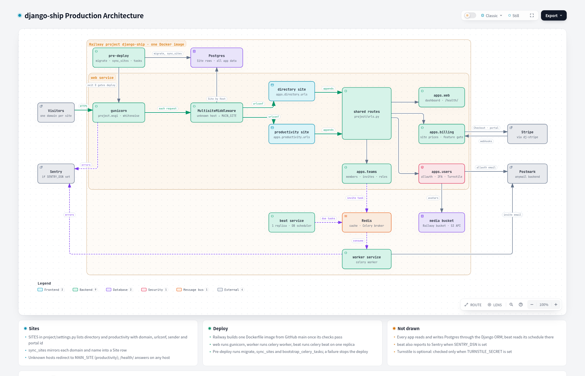
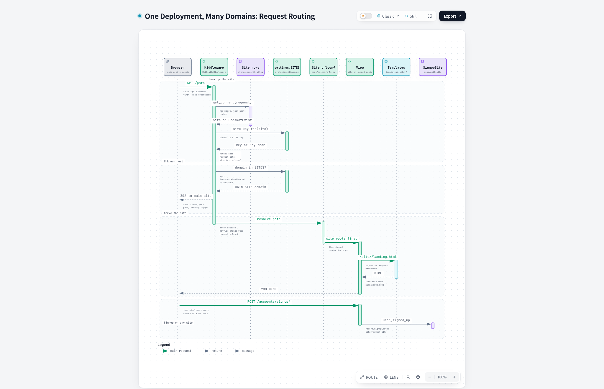
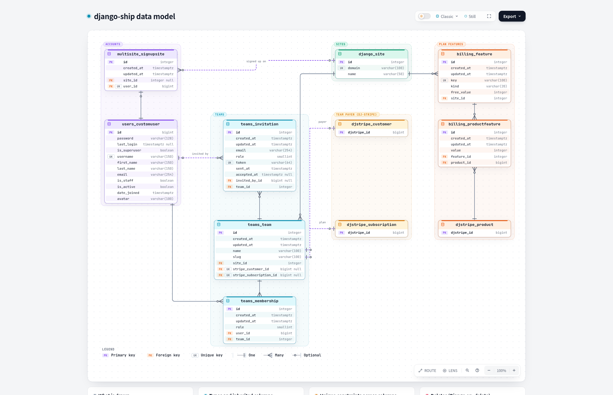

# django-ship

**One Django instance, many small projects.**

django-ship is a monorepo for exploratory projects. Each project is a Django app on its own domain, and all
of them share one deployment, one database and one hosting bill. Accounts, 2FA, teams and Stripe billing are
already built, so a new project starts with its first real page, not with a login form or a server.

> **Status: alpha.** It runs and deploys, but expect breaking changes, including to the data model.

Built on the open-source edition of [SaaS Pegasus](https://www.saaspegasus.com/). See [Credits](#credits).

    

[](docs/architecture/architecture.html)

## Pick this if

- **You don't want to self-host.** Railway runs everything from one config file, [`.railway/railway.ts`](.railway/railway.ts).
  You never log in to a server.
- **You don't want to write a separate front end, but you still want React.** Pages are Django templates with HTMX
  and Alpine.js, and any part that needs React mounts as a [React island](#react-where-you-need-it) inside the
  template. There's no API layer and no single-page app to keep in sync.
- **You want auth and billing on day one.** Sign-up, login, email verification, 2FA, teams with invitations and
  roles, and Stripe subscriptions with paid-feature gates all work out of the box, on every site.
- **You have several small ideas and don't want overhead for each one.** A new project is a Django app and a
  domain. It doesn't need its own server, database, pipeline or monthly bill.

## Don't pick this if

- A project needs its own database, its own release schedule or hard isolation from the others. Everything here
  shares one Postgres and ships together.
- You're building an API-first backend for a mobile app or a separate single-page app.
- You need something stable today. It's alpha.

## See how it fits together

Each diagram is a standalone HTML file in [`docs/architecture/`](docs/architecture/). Download one and open it in
a browser to pan, zoom, switch between light and dark, or export it.

| Diagram | What it shows |
| --- | --- |
| [Architecture](docs/architecture/architecture.html) | The Railway services built from one image, the apps inside web, and the outside services they call (the image above) |
| [Domain routing](docs/architecture/domain-routing.html) | How a request's domain picks the site, its URLs and its templates, and where unknown domains go |
| [Data model](docs/architecture/data-model.html) | Sites, users, teams, memberships, invitations and billing features, with every column |

[](docs/architecture/domain-routing.html)

[](docs/architecture/data-model.html)

## What you get

- 🌐 **Many sites, one deploy.** `apps/multisite` matches the request's domain to a site and sets `request.site`,
  `request.site_key` and `request.urlconf`. Unknown domains redirect to the main site.
- 🔐 **Accounts per site.** Sign-up, login, mandatory email verification and 2FA (TOTP and recovery codes)
  via [django-allauth](https://docs.allauth.org/), plus optional Cloudflare Turnstile on sign-up. The site a user
  signed up on is recorded.
- 👥 **Teams.** Email invitations, admin and member roles, and a guard that keeps every team from losing its last
  admin. Each site names its teams its own way (a "Business" on the directory, a "Team" on productivity).
- 💳 **Billing per site.** Team subscriptions through [dj-stripe](https://dj-stripe.dev/), with each site's own
  prices and its own Stripe Customer Portal configuration. Paid features are editable in the admin, and views are
  gated with `@feature_required("<site>.<feature>")`.
- ⚛️ **React islands.** React components mounted inside Django templates, with hot reload in development and a
  bundle in production.
- ⚙️ **The Pegasus stack.** Django 6 on Python 3.14, Postgres, Redis, Celery workers and beat, HTMX + Alpine.js,
  Tailwind v4 + DaisyUI built by Vite, a DRF API with a typed OpenAPI client, Ruff, mypy and GitHub Actions CI.
- 🚂 **Production on Railway.** One Docker image runs as web, worker and beat, with Postgres, Redis, an
  S3-compatible media bucket, Postmark email and Sentry.

## How a request finds its site

1. `SITES` in [`project/settings.py`](project/settings.py) is the source of truth: each site has a domain,
   name, urlconf, sender address, team label, analytics id and Stripe portal configuration.
2. `manage.py sync_sites` mirrors `SITES` into `django.contrib.sites` rows. The production pre-deploy step runs
   it after `migrate`.
3. On every request, `MultisiteMiddleware` looks up the `Site` for the host. It sets `request.site` and
   `request.site_key` and points `request.urlconf` at the site's `urls.py`.
4. Each site's `urls.py` holds its own pages and then appends the shared routes from
   [`project/urls.py`](project/urls.py): accounts, teams and billing.
5. Site pages render from `templates/<site>/`. Shared pages read the site from the request for branding.

The project has no `SITE_ID`. Outside a request there is no current site, so Celery tasks take a `site_id`
argument.

## Quick start

You need [Docker](https://www.docker.com/get-started), [uv](https://docs.astral.sh/uv/getting-started/installation/)
and [Node.js with npm](https://docs.npmjs.com/downloading-and-installing-node-js-and-npm).

```bash
make init   # copy .env.example to .env, start Postgres and Redis, migrate, install front-end packages
make dev    # Django and Vite with hot reload
```

The two sites answer on <http://directory.localhost:8000> and <http://productivity.localhost:8000>. Run
`make celery` in another terminal for background jobs, and `make stop` to stop the containers.

`scripts/setup-worktree.sh` gives each checkout or git worktree its own ports and its own Compose project, so
several checkouts can run side by side.

| Command | Does |
| --- | --- |
| `make test` | Run the test suite (`make test ARGS='apps.teams --keepdb'` for one app) |
| `make ruff` | Format and lint |
| `make type-check` | mypy with django-stubs |
| `make migrations` / `make migrate` | Create and apply migrations |
| `make manage ARGS='sync_sites'` | Any management command |
| `make` | List every target |

## Add a project

1. Create the app: `make uv run 'pegasus startapp <site>'`. Give it a `urls.py` that ends with
   `*shared_urlpatterns` from `project.urls`, the way [`apps/directory/urls.py`](apps/directory/urls.py) does.
2. Put its pages in `templates/<site>/`.
3. Add an entry to `SITES` in `project/settings.py`, with `<SITE>_DOMAIN` and `<SITE>_FROM_EMAIL` read from the
   environment.
4. Run `make manage ARGS='sync_sites'`.
5. For billing, create its Stripe products. `manage.py create_portal_configurations` then prints the
   `<SITE>_STRIPE_PORTAL_CONFIGURATION` value to set.

Tests set the host header through `SiteTestCase` and `site_client()` in
[`apps/multisite/tests/base.py`](apps/multisite/tests/base.py).

## React where you need it

Most pages are Django templates with HTMX and Alpine.js. When part of a page needs React, mount it as an island:

1. Write the component in `assets/javascript/islands/` and register it in
   [`assets/javascript/islands.tsx`](assets/javascript/islands.tsx).
2. Mark where it goes in the template: `<div data-island="TodayList" data-props='{"limit": 3}'></div>`.
3. Load the islands in the template's `page_js` block: `` then
   ``.

The productivity site's landing page has a working one ("Plan your day", in
[`templates/productivity/landing.html`](templates/productivity/landing.html)). An unregistered name throws in the
browser console instead of failing silently.

## Deploy

Production runs [`project/settings_production.py`](project/settings_production.py). It fails at startup instead
of falling back to placeholders: `SECRET_KEY`, `ADMINS`, the sender addresses, each site's domain and portal
configuration, the Stripe key for the active mode and the bucket keys are all required.
[`.env.example`](.env.example) lists every variable.

[`.railway/railway.ts`](.railway/railway.ts) declares the Railway project:

- **web** runs gunicorn, health-checked at `/health/`. Its pre-deploy step
  ([`deploy/pre_deploy.sh`](deploy/pre_deploy.sh)) runs `migrate`, `sync_sites` and `bootstrap_celery_tasks`.
- **worker** runs Celery, and **beat** runs the Celery scheduler with one replica.
- **Postgres**, **Redis** and a private **media bucket** are wired into all three services.

Deploys wait for the commit's GitHub Actions checks. Domains come from the shell when you apply:
`DIRECTORY_DOMAIN=… PRODUCTIVITY_DOMAIN=… railway config apply`. Set the GitHub repository in `railway.ts` to your
own before applying. Web, worker and beat deploy separately, so each migration must work with the previous
release's code.

## Staying on Pegasus

Pegasus releases land as merges on its `main`. Add it as the `upstream` remote and merge from your main branch:

```bash
git remote add upstream https://github.com/saaspegasus/django-boilerplate.git
git fetch upstream && git merge upstream/main
```

New code lives in new apps (`multisite`, `teams`, `billing`, `directory`, `productivity`), and Pegasus's own
files are changed as little as possible, so these merges stay small. The Pegasus code follows the
[Pegasus documentation](https://docs.saaspegasus.com/).

## Building with Claude Code

The repo is set up for [Claude Code](https://claude.com/claude-code). [`CLAUDE.md`](CLAUDE.md) holds the
project rules: the multi-site rules, fail-loud error handling, and evidence in every commit.
[`docs/workflow.md`](docs/workflow.md) describes the loop:

1. `/interview-me-engineering` turns one sentence into a spec in `docs/specs/<nn>-<feature>/spec.md`.
2. `/implement` builds it in a fresh session and keeps `implementation-notes.md` beside the spec.
3. `/commit-push-pr` opens the pull request.

`.claude/skills/` has the Pegasus skills for merge conflicts, type fixes and dependency upgrades. `.mcp.json`
gives the session read access to Postgres and a Playwright browser.

## Project layout

```
apps/
  multisite/     domain → site middleware, sync_sites, signup-site record
  directory/     the directory site's pages and the featured-listing paid feature
  productivity/  the productivity site's pages and the export paid feature
  teams/         teams, memberships, invitations and roles
  billing/       dj-stripe subscriptions, per-site prices and portals, feature gates
  users/         custom user, allauth adapters, 2FA, Turnstile sign-up
  web/           shared pages, health check, template tags
  utils/         BaseModel (created_at, updated_at)
project/         settings, settings_production, shared urls, Celery
templates/       shared templates plus one folder per site
assets/          JavaScript and CSS built by Vite, including the React islands
.railway/        Railway infrastructure as code
deploy/          pre-deploy script
docs/            architecture diagrams, feature specs, the Claude Code workflow
.claude/         Claude Code commands and skills
```

## Credits

django-ship is built on the open-source edition of [SaaS Pegasus](https://www.saaspegasus.com/) by Elodin Labs
LLC. Pegasus provides the Django project structure, authentication, the front-end pipeline, the tooling and its
Claude Code skills. django-ship adds the multi-site layer, teams, 2FA, per-site Stripe billing and the Railway
deploy. If you're building one serious SaaS product rather than a portfolio of small ones, look at
[SaaS Pegasus Pro](https://www.saaspegasus.com/).

## License

[MIT](LICENSE), like the Pegasus open-source edition it's built on.
